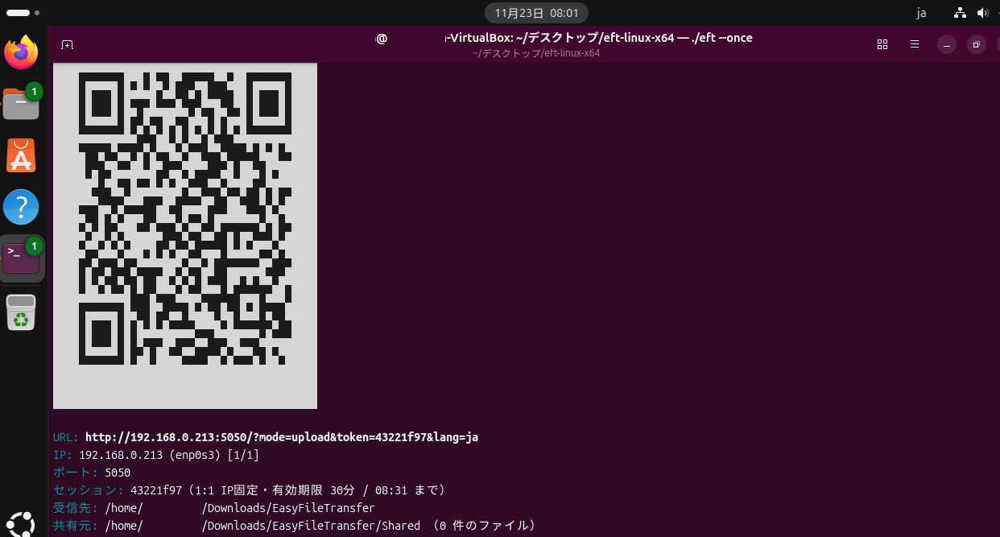

# EasyFileTransfer（簡単ファイル転送）

[](https://github.com/kumatarosasaki3891-art/EasyFileTransfer/releases)
[](https://apps.microsoft.com/detail/9N4G1LLL2VZP?hl=ja&gl=JP&ocid=pdpshare)
[](LICENSE)

[English](README_EN.md) | 日本語

スマホとPC・サーバーの間で、QRコードを読み取るだけでファイルを双方向にやり取りできるローカルファイル転送ツールです。  
外部サーバーやインターネット回線を経由せず、同じ Wi-Fi（LAN）内だけで直接通信する仕組みになっています。

> A fast, local-first file transfer tool between your smartphone and PC/server (Windows / Linux GUI & headless CLI `eft`) via QR code—no cloud, no account, and no mobile app required.

---

## 📥 ダウンロード / Download

- **🐧 Linux版 (Flatpakバンドル / CLI `eft`)**: [GitHub Releases からダウンロード](https://github.com/kumatarosasaki3891-art/EasyFileTransfer/releases/latest)
- **🪟 Windows 10 / 11版**: [Microsoft Store から無料で入手](https://apps.microsoft.com/detail/9N4G1LLL2VZP?hl=ja&gl=JP&ocid=pdpshare)

---

## 📸 画面イメージ / Screenshots

<!-- ↓ GitHubの編集画面にスクリーンショット画像やデモ動画(.webm)をドラッグ＆ドロップして貼り付けてください -->
| PC側メイン画面（受信・QR表示） | スマホ側ブラウザ画面（アプリ不要） |
| :---: | :---: |
|  |  |

| CLI版（`eft`）実行画面（端末でのQRコード表示・待ち受け） |
| :---: |
|  |

---

> 初めてオープンソースとして公開してみます。  
> 勉強しながら組んだコードなので拙い部分もあるかと思いますが、同じようなツールを作ってみたい方の参考になれば嬉しいです！

---

## 主な特徴

- **スマホ側に専用アプリ不要**
  - PC側で表示したQRコードをスマホのカメラで読み取ると、ブラウザ上で送受信用のWeb画面が開きます。
- **双方向ファイル転送**
  - **受信モード（スマホ → PC）**: スマホからファイル選択・カメラ撮影・ドラッグ＆ドロップでPCへ送信できます（1ファイル最大 2GB まで）。同名ファイルがある場合は自動で `(1)` `(2)` を付けて別名保存します。
  - **送信モード（PC → スマホ）**: PCの共有フォルダーに入れたファイルを、スマホ側のブラウザから一覧表示・ダウンロードできます。
- **管理者権限不要の軽量HTTPサーバー (`FileTransferServer.cs`)**
  - `HttpListener` ではなく `TcpListener` ベースで実装しているため、Windows で UAC 管理者権限や複雑な `netsh` 設定なしで起動できます（デフォルトポート `5050`、使用中なら空きポートを自動探索）。
- **1:1 使い捨てセッション保護**
  - ランダムな8桁のセッショントークン（有効期限30分）を発行し、最初に接続した端末のIPアドレスに紐づけることで、同じネットワーク内の別端末からのアクセスをブロックします。
- **QRコードの自前生成 (`QrCodeGenerator.cs`)**
  - 外部のQR生成ライブラリを増やさずに動かしたかったため、`SkiaSharp` を使って ISO/IEC 18004（Version 1〜7）のQRコード描画を実装しています。
- **11言語対応 (`LocalizationService.cs`)**
  - PC側UI・スマホ側Web画面ともに、日本語・英語・簡体字中国語・韓国語・繁体字中国語・ベトナム語・スペイン語・ドイツ語・フランス語・ポルトガル語・イタリア語の11言語切り替えに対応しています。
- **Windows版 (.NET MAUI) & Linux版 (Avalonia UI) & CLI版 (`eft`)**
  - モデルとサーバー/QR/多言語ロジックを共有し、UI部分（MAUI / Avalonia / 端末CLI）だけをプラットフォーム・用途ごとに作っています。
- **ヘッドレスサーバー / NAS 向け CLI 版 (`eft`)**
  - GUI 版と同じ転送サーバー・セキュリティ・11言語エンジンを搭載し、端末の半ブロック QR 表示・1つの QR / 1画面での双方向転送・`--once`・`--timeout`・終了コードに対応しています。

---

## 使い方

1. PC とスマホを**同じ Wi-Fi（同一ネットワーク）**に接続します。
2. PC でアプリを起動します（Linux版は `flatpak install ./EasyFileTransfer-1.1.0-v3.flatpak` でインストールしてから起動）。
3. **スマホ → PC に送りたいとき**
   - 「受信 (スマホ → PC)」タブを開き、スマホの標準カメラでQRコードをスキャンします。
   - 開いたWeb画面で写真やファイルを選んで送信すると、PCの保存先フォルダー（初期値: `Downloads/EasyFileTransfer`）へ保存されます。
4. **PC → スマホ に送りたいとき**
   - 「送信 (PC → スマホ)」タブを開き、「＋ ファイルを追加」ボタン（または共有フォルダー `Downloads/EasyFileTransfer/Shared` への直接配置）でファイルを用意します。
   - スマホでQRコードをスキャンして、表示された一覧からダウンロードします。

> **つながらないときのヒント**
> - PCに仮想ネットワーク（WSL / Docker / Hyper-V / VPN など）があると別IPが選ばれることがあるため、画面の「🔄 IP切替」ボタン（CLIでは `--ip <addr>`）を試してみてください。
> - ルーターの「プライバシーセパレーター（AP分離）」が有効になっていると端末同士が通信できないため、無効化されているかご確認ください。
> - ファイアウォール（Windows Defender / `ufw` 等）のブロックが出た場合は、ローカルネットワークでの通信ポートを許可してください。

---

## 💻 CLI 版（`eft`）— ヘッドレスサーバー・NAS 対応

画面のない（ヘッドレス）Linux サーバーや NAS からでも、GUI 版と同一のサーバー・セキュリティ設計でファイルをやり取りできる CLI 版（`eft`）を備えています。  
サブコマンドで送信・受信を分けず、**起動した1つの QR コード・1つのスマホ画面で送受信の両方向**をそのまま利用できます（停止は `Ctrl+C`）。

### 使用例

```bash
# 引数なしで起動（端末に半ブロック QR コードを表示し、送受信両方向で待ち受け）
eft

# 受信先と共有元フォルダーを指定して起動
eft --dir ./incoming --share ./outbox

# 仮想 NIC 環境で IP を明示し、ポート・初期言語を指定
eft --ip 192.168.1.50 --port 8080 --lang en

# 1回の転送完了で自動終了（スクリプト連携用、QR非表示）
eft --once --no-qr
```

### 主なオプション

| オプション | 既定値 | 内容 |
| --- | --- | --- |
| `-p, --port <n>` | `5050` | 待ち受けポート（使用中なら +10 まで自動探索） |
| `-d, --dir <path>` | 設定値 / `~/Downloads/EasyFileTransfer` | スマホから受信したファイルの保存先（この実行中のみ上書き） |
| `-s, --share <path>` | 設定値 / `~/Downloads/EasyFileTransfer/Shared` | スマホへ渡すファイルを置く共有フォルダー（この実行中のみ上書き） |
| `--ip <addr>` | 候補の最優先 | 待ち受け URL / QR に使うローカル IPv4 アドレスを明示指定 |
| `-l, --lang <code>` | 設定値 / OS言語 | 表示とスマホ側ページの初期言語（`ja`, `en`, `zh`, `zh-TW`, `ko`, `vi`, `es`, `de`, `fr`, `pt`, `it`） |
| `-t, --timeout <min>` | `30` | セッションの有効期限（分、1〜1440） |
| `--once` | なし | 1回のファイル転送（受信または送信）完了後に自動終了 |
| `--no-qr` | なし | QR を描かず URL のみ表示（パイプ・リダイレクト時は自動有効） |
| `--qr-plain` | なし | 端末 QR コードの ANSI 前景・背景色付けを無効化 |
| `--no-color` | なし | テキストの ANSI カラー出力を無効化 |
| `-q, --quiet` | なし | 進捗ログと補足案内を抑え、重要情報と転送結果行のみ出力 |
| `-v, --version` | — | バージョン・Releases URL を表示 |
| `-h, --help` | — | ヘルプを表示 |

### 終了コード

| コード | 意味 |
| :---: | --- |
| `0` | 正常終了（`Ctrl+C`、または `--once` / セッション有効期間内に転送完了） |
| `1` | 転送が1件も成立せずにセッション期限切れ |
| `2` | 引数・オプションまたはパスの指定誤り |
| `3` | サーバー起動失敗などの実行時エラー |

### `qrcp` との違い

| 観点 | `qrcp` | `eft` (EasyFileTransfer CLI) |
| --- | --- | --- |
| **形態** | CLI 専用 | GUI（Windows MAUI / Linux Avalonia）とコアを共有するハイブリッド構成 |
| **アクセス制御** | ランダムな URL パスのみ | **8文字の16進数セッショントークン（有効期限付き）＋初回接続元IP固定（1:1保護）** |
| **送受信の操作** | `send` と `receive` が別コマンド・別画面 | **1つの QR・1つの画面で送受信の両方向に対応**（サブコマンド不要） |
| **対応言語** | 英語のみ | CLI 表示・スマホ側 Web ページともに **11言語対応** |
| **IP 選択** | インターフェース指定が中心 | 仮想 NIC（WSL / Docker / VPN 等）を除いた優先度付き候補提示＋`--ip` 指定 |

### ソースからの実行・単一バイナリのビルド（.NET 10 SDK）

```bash
# CLI の実行
dotnet run --project EasyFileTransfer.Cli/EasyFileTransfer.Cli.csproj -- --help

# Linux向け 自己完結型・単一ファイルバイナリの作成（.NET ランタイム不要）
dotnet publish EasyFileTransfer.Cli/EasyFileTransfer.Cli.csproj \
  -c Release \
  -r linux-x64 \
  --self-contained true \
  -p:PublishSingleFile=true \
  -p:PublishTrimmed=false \
  -o ./publish/eft-linux-x64

# 配布用 tar.gz の作成例
tar czf eft-linux-x64.tar.gz -C ./publish/eft-linux-x64 eft
```

---

## ディレクトリ構成

```text
EasyFileTransfer/
├── EasyFileTransfer/                  # Windows 向けアプリ (.NET MAUI / net10.0-windows10.0.19041.0)
│   ├── Models/                        # 受信・共有ファイル情報のモデル (Linux/CLI版と共有)
│   ├── Services/                      # HTTPサーバー・QR生成・多言語・フォルダー設定
│   ├── Platforms/                     # プラットフォーム別エントリーポイント / Package.appxmanifest
│   ├── MainPage.xaml(.cs)             # メイン画面UIとロジック
│   └── STORE_PUBLISH_GUIDE.md         # Microsoft Store 申請メモ (識別情報はマスク済み)
├── EasyFileTransfer.Linux/            # Linux / クロスプラットフォーム版 (Avalonia UI / net10.0)
│   ├── Services/                      # XDG Base Directory 対応の設定永続化 (config.json)
│   ├── ViewModels/                    # MVVM ViewModel (CommunityToolkit.Mvvm)
│   ├── Views/                         # Avalonia ウィンドウ定義
│   └── README.md                      # Linux版の補足ドキュメント
├── EasyFileTransfer.Cli/              # CLI 版 (eft / net10.0、外部NuGet依存なし)
│   ├── Services/                      # 端末半ブロックQR描画・CLI向け設定参照 (StorageSettings)
│   ├── CliApp.cs                      # サーバーライフサイクル・イベント出力・終了コード制御
│   ├── CliMessages.cs                 # 11言語 CLI メッセージ・言語コードパーサ
│   ├── CliOptions.cs                  # 引数パーサ・バリデーション
│   └── Program.cs                     # エントリーポイント
├── tests/
│   └── EasyFileTransfer.Cli.Tests/    # CLI 単体テスト & ライブ HTTP E2E 検証スイート
├── build-msix-easyfiletransfer.ps1    # Windows MSIX パッケージ作成用 PowerShell スクリプト
├── build-msix-easyfiletransfer.cmd    # 上記スクリプトのランチャー
├── EasyFileTransfer.sln               # ソリューションファイル
└── EasyFileTransfer.slnx              # XML ソリューションファイル
